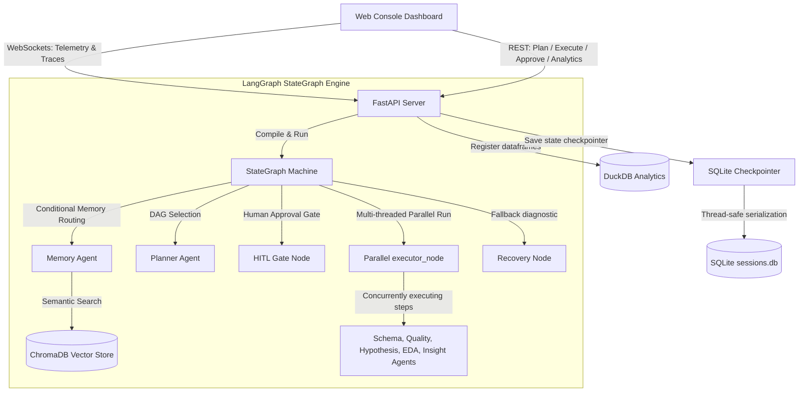
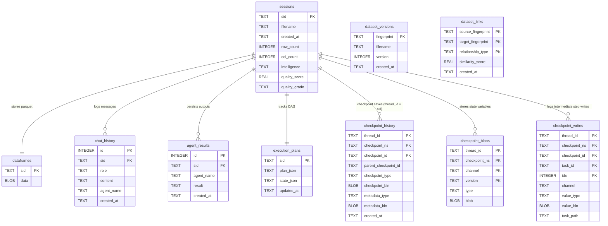
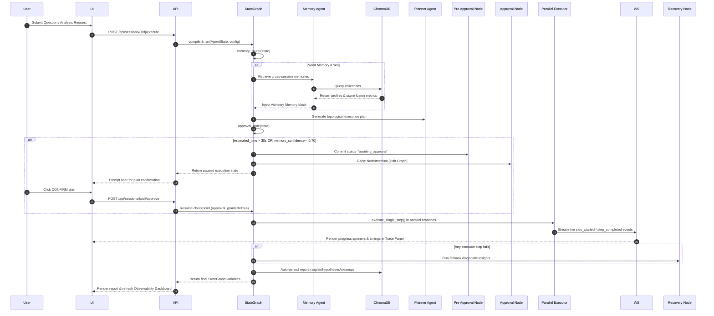

# 🏛️ System Architecture — Pro v4.0

This document details the underlying architecture of the **Agentic AI Data Scientist Platform (v4.0)**, explaining the core components, database ER schemas, compiled LangGraph StateGraph topology, memory fusion scoring, and observability metrics.

---

## 1. System Topology

The platform integrates a FastAPI web server, a multi-threaded parallel Execution Engine powered by LangGraph, a persistent local ChromaDB vector memory space, a relational SQLite session store, and a premium observability console.

---

## 2. Database & Schema Architectures

The database is built on SQLite (for structured metadata, lineages, execution states, and checkpointer steps) and ChromaDB (for time-decayed vector database memory).

### 2.1 SQLite Schema (Relational & Lineage DB)

### 2.2 ChromaDB Collections (Vector Knowledge Base)

1. **`datasets` Collection**:
   - *Document*: Generated text summary describing features, data shapes, and inferred domain.
   - *Metadata*: `sid`, `fingerprint`, `filename`, `dataset_type`, `domain`, `version`, `row_count`, `col_count`, `quality_score`, `reuse_count`, `created_at`.
2. **`insights` Collection**:
   - *Document*: Synthesized reports and patterns.
   - *Metadata*: `sid`, `dataset_fingerprint`, `agent`, `title`, `confidence`, `reuse_count`, `created_at`.
3. **`hypotheses` Collection**:
   - *Document*: Formulated hypothesis statement.
   - *Metadata*: `sid`, `dataset_fingerprint`, `hypothesis`, `status`, `evidence_score`, `confidence`, `reuse_count`, `created_at`.
4. **`cleaning_actions` Collection**:
   - *Document*: Transformations and missing data imputation logs.
   - *Metadata*: `sid`, `dataset_fingerprint`, `column`, `action_type`, `created_at`.

---

## 3. LangGraph Execution Lifecycle

The compiled state machine orchestrates the execution flow from ingestion through memory injection, planning, human confirmation checkpoints, concurrent task execution, and recovery.

---

## 4. Platform Analytics & Instrumentation

The dashboard aggregates database execution traces to render telemetry calculations without altering database models:
- **Parallel Speedup**: Calculated by comparing total sum of step durations with parallel executor node duration.
- **Retry Frequency**: Monitors step failures and tracks exponential backoff retries.
- **Memory Quality**: Evaluates ChromaDB vector lookups, computing average retrieval confidence and rejection rate based on the `0.65` threshold gate.
- **Deployment Auditing**: Visualizes version distribution counts of compiled `graph_version` configurations.
