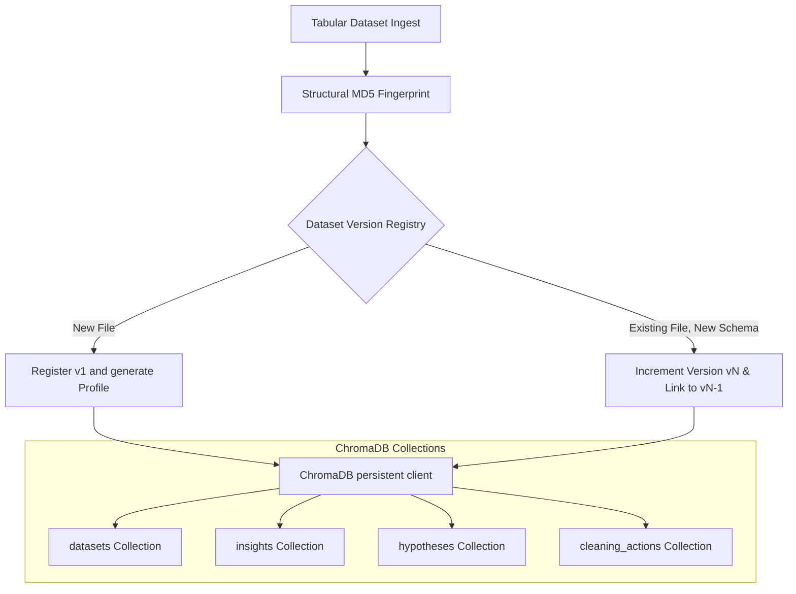

# 🧠 Memory & Knowledge Layer Architecture — Pro v4.0

This document outlines the design and implementation of the semantic, cross-session memory layer of the platform, built on ChromaDB, local Nomic embeddings, and a custom score fusion rank selection system.

---

## 1. Memory Store Architecture

The memory layer uses a persistent local vector database to store and retrieve contextual metadata, historical insights, validated hypotheses, and successful data-cleaning workflows across analytical sessions.



### 1.1 ChromaDB Collection Schemas

- **`datasets` Collection**: Stores structural profiles.
  - *Document text*: "Dataset filename: sales.csv. Shape: 100 rows x 5 columns. Target candidate: Revenue. Numeric fields: Age, Price. Inferred Domain: E-commerce Transactions."
  - *Metadata*: `sid`, `fingerprint`, `filename`, `dataset_type`, `domain`, `version`, `row_count`, `col_count`, `quality_score`, `reuse_count`, `created_at`.
- **`insights` Collection**: Stores report findings.
  - *Document text*: "Identified strong correlation (r=0.89) between marketing spend and customer acquisition."
  - *Metadata*: `sid`, `dataset_fingerprint`, `agent`, `title`, `confidence`, `reuse_count`, `created_at`.
- **`hypotheses` Collection**: Stores formulated analytical assertions.
  - *Document text*: "Hypothesis: Null hypothesis that mean conversion rates are equal across seasonal segments is rejected."
  - *Metadata*: `sid`, `dataset_fingerprint`, `hypothesis`, `status`, `evidence_score`, `confidence`, `reuse_count`, `created_at`.
- **`cleaning_actions` Collection**: Stores data imputation recommendations.
  - *Document text*: "Column 'Age' imputed using median value. Null count decreased from 12% to 0%."
  - *Metadata*: `sid`, `dataset_fingerprint`, `column`, `action_type`, `created_at`.

---

## 2. Nomic Text Embeddings & Deterministic Fallback

Semantic vectors are generated using the local Ollama `nomic-embed-text:latest` model, mapping text to a 768-dimensional space.

To guarantee reliability in offline or CI/CD test environments, the engine implements a **deterministic hash-seeded generator fallback**:
- Computes a SHA-256 hash of the input text string.
- Seeds a pseudo-random number generator (PRNG) with the integer value of the hash.
- Generates a normal-distribution vector ($\mu=0.0$, $\sigma=1.0$) of 768 dimensions.
- Normalizes the vector to unit length ($L_2$ norm).
- Ensures that identical texts produce identical vector signatures under testing, avoiding remote connection timeouts.

---

## 3. Score Fusion Ranking Algorithm

To retrieve the most relevant past profiles, the memory store ranks retrieved candidates using a multidimensional **Score Fusion** algorithm:

$$\text{Rank Score} = 0.50 \cdot S_{\text{Similarity}} + 0.20 \cdot C_{\text{Quality}} + 0.20 \cdot R_{\text{Reuse}} + 0.10 \cdot D_{\text{Decay}}$$

1. **Vector Similarity ($S_{\text{Similarity}}$)**: Cosine similarity derived from ChromaDB Euclidean distance:
   $$S_{\text{Similarity}} = \max\left(0.0, 1.0 - \frac{\text{Distance}}{2}\right)$$
2. **Quality Confidence ($C_{\text{Quality}}$)**: The historical dataset data health score (scaled $0.0$ to $1.0$).
3. **Reuse Score ($R_{\text{Reuse}}$)**: Log-scaled counter to prioritize frequently accessed profiles:
   $$R_{\text{Reuse}} = \min\left(1.0, \frac{\ln(1 + \text{reuse\_count})}{\ln(10)}\right)$$
4. **Time Decay ($D_{\text{Decay}}$)**: Exponential decay to penalize older memories, having a half-life of 14 days:
   $$D_{\text{Decay}} = e^{-0.05 \cdot \Delta t}$$
   where $\Delta t$ is the number of days elapsed since the memory was registered.

---

## 4. Prompt Contamination Safeguards

To prevent target leakage, LLM hallucinations, and memory contamination, the system enforces three layers of isolation:

### 4.1 Memory Confidence Gate
If a retrieved dataset profile's fused score falls below the threshold:
$$\text{Rank Score} < 0.65$$
the memory is rejected, not exposed to the planner, and logged as a memory rejection.

### 4.2 Advisory Prompt Isolation
Retrieved memories are formatted as strictly advisory-only context, wrapped in clear Markdown banners. System prompts emphasize that the current dataset's statistical profile is the absolute source of truth.

```markdown
## ADVISORY HISTORY (MEMORY)

Based on a semantically similar historical dataset (sales_v1.csv, Fused Score: 0.84),
the following cleaning steps and hypotheses were recorded:
- Cleaning: Imputed missing prices using median values.
- Hypothesis: Seasonal trends affect sales peaks.

> [!CAUTION]
> Historical knowledge is advisory only. Target variables and statistical distributions
> must be validated against current dataset profiles.
```

---

## 5. Memory Quality Analytics

The platform analytics dashboard computes retrieval telemetry from the session history:
- **Acceptance Rate**: Percentage of queried memory candidates scoring $\ge 0.65$.
- **Rejection Rate**: Percentage of candidates blocked by the confidence gate.
- **Average Confidence**: The mean fused rank score of all vector lookups.
