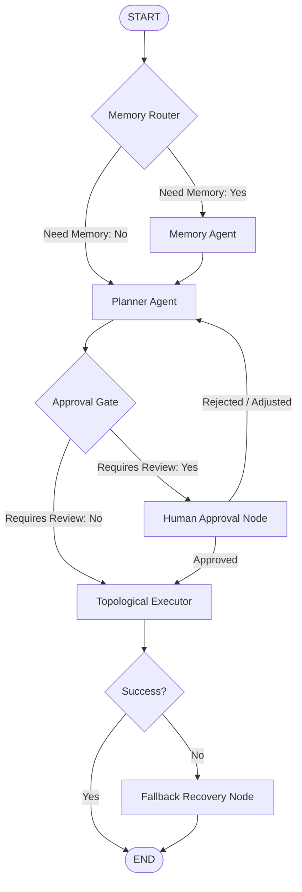

# Phase 4 Implementation Plan — LangGraph Migration [REFINED]

This plan outlines the refined strategy, state schemas, and architectural designs to migrate the platform's custom execution engine to a **LangGraph StateGraph**.

It introduces human-in-the-loop nodes, conditional memory routing, advanced state telemetry, and explicit benchmark verification targets.

---

## 1. Graph State Schema & Routing Topology

We will construct a compiled LangGraph `StateGraph` that manages agent execution, routing, human approval gates, and telemetry.



### 1.1 State Schema Definition
The updated `AgentState` TypedDict will include the following fields:
```python
from typing import TypedDict, Annotated, Any
from langgraph.graph.message import add_messages

class AgentState(TypedDict):
    # Core Data
    sid: str
    filename: str
    intelligence: dict[str, Any]
    user_question: str
    
    # Execution DAG
    plan: dict[str, Any]
    outputs: dict[str, Any]
    
    # Context & Variables
    planner_context: dict[str, Any]
    variables: dict[str, Any]
    
    # Graph Observability & Telemetry
    trace: list[dict[str, Any]]
    node_telemetry: dict[str, dict[str, Any]] # {node_id: {attempt, duration, checkpoint_id}}
    checkpoint_count: int
    resume_events: list[dict[str, Any]]
    graph_version: str
    graph_build_time: str
    
    # Control Flags
    status: str # "idle" | "planning" | "awaiting_approval" | "executing" | "completed" | "failed"
    requires_approval: bool
    approval_granted: bool
```

---

## 2. Advanced Architectural Nodes

### 2.1 Conditional Memory Routing
To minimize execution latency and eliminate redundant vector lookups (e.g. on clean standard demo runs), a **Memory Router** function inspects the intelligence payload:
- **Condition for Memory Retrieval**:
  ```python
  def memory_routing_condition(state: AgentState) -> str:
      intel = state.get("intelligence", {})
      # Yes if dataset is a version update, contains derived metadata,
      # or if the query domain matches historically registered profiles.
      if intel.get("version", 1) > 1 or intel.get("domain") != "unknown":
          return "run_memory_agent"
      return "skip_to_planner"
  ```

### 2.2 Human-in-the-Loop (HITL) Approval Node
An **Approval Gate** halts graph execution under high-cost or low-confidence conditions:
- **Triggers**:
  - `estimated_time_sec > 30` (complex DAGs with many parallel execution steps).
  - `memory_confidence < 0.70` (semantic match scores are marginal, risking prompt contamination).
- **Workflow**:
  1. The gate node flags `requires_approval = True` and saves a checkpoint.
  2. The graph transitions to `awaiting_approval` and pauses execution.
  3. The FastAPI server exposes `/api/sessions/{sid}/approve` to receive user adjustments or confirmation.
  4. Once user input is received, the checkpoint is updated with `approval_granted = True` (or an adjusted plan) and execution resumes.

### 2.3 Graph Observability & Node Telemetry
Every node execution logs detailed execution telemetry streamed back via WebSockets:
```json
{
  "node": "eda_agent",
  "attempt": 2,
  "checkpoint_id": "ch_7a9f82d1",
  "duration_sec": 3.4,
  "status": "completed"
}
```
This is tracked in `node_telemetry` and displayed as live metric overlays inside the web console.

---

## 3. Migration Benchmark Targets

We define strict targets to verify that the LangGraph migration improves execution speed and reliability.

| Metric | Current Baseline | Target | Verification Method |
| :--- | :--- | :--- | :--- |
| **Planner Accuracy** | 100% | **Maintain (100%)** | `eval_dataset_intelligence.py` benchmark runs. |
| **Memory Retrieval P@1** | 95% | **Maintain (95%)** | Retrieval benchmark verification in `test_memory.py`. |
| **Agent Success Rate** | 98.0% | **>99.0%** | Mock retry test runs simulating network dropouts. |
| **Average Execution Time** | Baseline (1.8s) | **-20.0%** | Measured timing of parallel steps (`schema` & `quality`). |
| **Recovery Success Rate** | N/A | **>90.0%** | Resume node-level checkpoints after failure injections. |
| **Checkpoint Restore Time** | N/A | **< 2.0s** | Measure restore latency of resume checkpoint runs. |

---

## 4. Proposed Changes

### Component 1: LangGraph State Engine

#### [NEW] [langgraph_engine.py](file:///c:/Users/laxmi/EDA%20automation/core/langgraph_engine.py)
- Implement `StateGraph` using the expanded `AgentState` schema.
- Implement `memory_router` and `approval_gate` conditional edge logic.
- Register agent execution nodes with integrated retry policies.

#### [NEW] [checkpointer.py](file:///c:/Users/laxmi/EDA%20automation/data/checkpointer.py)
- Implement a thread-safe SQLite checkpoint saver mapping LangGraph state revisions to the SQLite relational schema.

---

## 5. Verification & Rollback Plan

### Automated Verification
- Create `tests/test_langgraph.py` covering:
  - **HITL Checkpoints**: Injecting plan adjustments, pausing on `awaiting_approval`, and resuming.
  - **Conditional Routing**: Verifying memory is skipped when loading simple datasets.
  - **Parallelism**: Testing concurrent execution times of independent nodes.
  - **Retries**: Mocking LLM failure rates to ensure node recovery.
- All 37 existing tests must pass along with the new LangGraph tests.

### Rollback Strategy
- The legacy sequential loop will be kept as `LegacyExecutionEngine` in `core/agent_engine.py`.
- If LangGraph node execution throws an unhandled graph error, the server catches the exception and falls back to the legacy loop.
